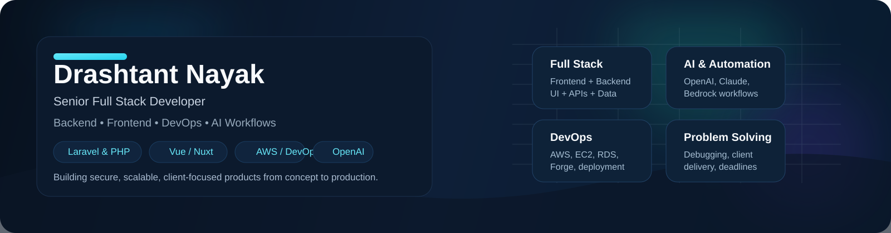

<div align="center">



<br />

[](https://drashtantnayak.ca/)
[](https://www.linkedin.com/in/drashtant-nayak/)
[](mailto:drashtant391993@gmail.com)

**Calgary, Canada** · **8+ years building software** · **Remote collaboration**

</div>

### Building reliable software with an intelligent edge

I'm a senior full stack developer focused on production SaaS platforms, modern **Laravel APIs**, polished **Vue experiences**, dependable integrations, cloud delivery, and practical AI-powered workflows. I work across the full lifecycle, from architecture and development to security, performance, and deployment.

<table>
<tr>
<td width="33%" valign="top"><b>01 / BACKEND</b><br/><br/>Laravel architecture, APIs, authentication, queues, multi-user SaaS systems and integrations.</td>
<td width="33%" valign="top"><b>02 / FRONTEND</b><br/><br/>Vue, Nuxt, Inertia, responsive UI, accessible design and complete product experiences.</td>
<td width="33%" valign="top"><b>03 / DELIVERY</b><br/><br/>Cloud infrastructure, data modelling, CI/CD, monitoring, performance and AI workflows.</td>
</tr>
</table>

## Technical toolkit

A practical stack for building, running and improving real-world applications.

### Backend and application architecture


### Frontend and product engineering


### UI, design and user experience


### AI and intelligent workflows


### Databases, caching and performance


### Cloud, infrastructure and delivery


### Security, integrations and identity


## How I approach engineering

```text
DISCOVER  →  ARCHITECT  →  BUILD  →  HARDEN  →  LAUNCH
   │            │           │          │          │
Define       Design      Deliver    Validate   Deploy and
outcomes     systems     features   quality    observe
```

- **Architect for change:** clear boundaries, maintainable modules and thoughtful data flow.
- **Build for production:** secure defaults, queues, permissions, retries and useful logs.
- **Design for people:** accessible interfaces, polished interactions and responsive layouts.
- **Deliver end to end:** from the database and API to the frontend and infrastructure.

## GitHub activity

<div align="center">


<sub>These widgets summarize public GitHub activity and do not represent all professional or private work. Third-party statistics may occasionally be unavailable.</sub>

</div>

## Let's connect

I enjoy building and modernizing SaaS platforms, integration-heavy systems, AI-assisted workflows and applications that need a dependable backend and a polished interface.

**[View my work and experience](https://drashtantnayak.ca/)** · **[Connect on LinkedIn](https://www.linkedin.com/in/drashtant-nayak/)** · **[Send an email](mailto:drashtant391993@gmail.com)**
