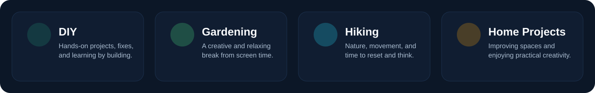

<div align="center">


<br />

[](https://drashtantnayak.ca/)
[](https://www.linkedin.com/in/drashtant-nayak/)
[](mailto:drashtant391993@gmail.com)

**Calgary, Canada** · **8+ years of professional experience** · **Full stack delivery from idea to production**

</div>

## Senior full stack developer focused on building dependable software

I'm a senior full stack developer with 8+ years of experience building **SaaS platforms, business applications, client portals, integrations, payment workflows, AI-powered features, and production-ready web systems**.

My work spans the full delivery lifecycle — **backend architecture, frontend UI, DevOps, cloud infrastructure, debugging, performance tuning, security hardening, and real-world problem solving under pressure**. I enjoy turning unclear requirements into practical solutions and helping teams ship reliable products on hard deadlines.

<table>
<tr>
<td width="33%" valign="top"><b>01 / BACKEND</b><br/><br/>Laravel application architecture, APIs, queues, integrations, database design, secure business logic, payment processing, and scalable SaaS backends.</td>
<td width="33%" valign="top"><b>02 / FRONTEND</b><br/><br/>Vue 3, Nuxt, Inertia, Tailwind CSS, responsive UI, polished user flows, and complete product experiences that feel clean and modern.</td>
<td width="33%" valign="top"><b>03 / DEVOPS & DELIVERY</b><br/><br/>AWS, EC2, RDS, Laravel Forge, deployment pipelines, server setup, issue triage, production debugging, and release confidence.</td>
</tr>
</table>

## What I bring to projects

- **True full stack ownership** — comfortable across backend, frontend, infrastructure, design polish, and deployment.
- **Client-focused delivery** — solving real client problems with practical solutions instead of overengineering.
- **Strong debugging mindset** — troubleshooting production issues, data problems, edge cases, queue failures, and integration bugs.
- **Experience across industries** — SaaS, agency work, service businesses, operations tooling, client management systems, and web platforms.
- **Fast execution under deadlines** — able to multitask, prioritize, communicate clearly, and keep delivery moving in high-pressure situations.
- **Secure and reliable engineering** — authentication, authorization, validation, logging, retries, observability, and secure application patterns.

## Technical toolkit

A practical stack for building, launching, and maintaining real-world software.

### Backend and application architecture


### Frontend and product engineering


### UI, design and user experience


### AI and intelligent workflows


### Databases, caching and performance


### Cloud, infrastructure and delivery


### Security, integrations and payments


## Engineering style

```text
DISCOVER  →  ARCHITECT  →  BUILD  →  DEBUG  →  HARDEN  →  LAUNCH
   │            │           │         │          │           │
Understand   Design      Deliver   Solve      Secure      Deploy and
business     systems     features  issues     quality     observe
```

- **Full stack execution:** from database and API design to polished UI and production deployment.
- **Real-time troubleshooting:** comfortable debugging urgent issues, broken flows, deployment incidents, and third-party integrations.
- **Business-aware development:** balancing clean code with client needs, deadlines, and product priorities.
- **Reliable delivery:** validation, access control, queue handling, monitoring, testing, logging, and practical fail-safes.

## A few things outside of code



I also enjoy hands-on hobbies that keep me creative and grounded:

- **DIY projects**
- **Gardening**
- **Hiking**
- **Home improvement projects**

## GitHub activity

<div align="center">


<sub>These widgets summarize public GitHub activity and do not represent all professional or private work. Third-party statistics may occasionally be unavailable.</sub>

</div>

## Let's connect

I enjoy building **SaaS products, full stack web platforms, AI-enhanced tools, integration-heavy systems, and reliable business applications** that need strong backend logic, polished frontend experiences, and dependable delivery.

If you're looking for someone who can work across **backend, frontend, DevOps, debugging, and client-focused problem solving**, I'd be happy to connect.

**[View my portfolio](https://drashtantnayak.ca/)** · **[Connect on LinkedIn](https://www.linkedin.com/in/drashtant-nayak/)** · **[Send an email](mailto:drashtant391993@gmail.com)**
